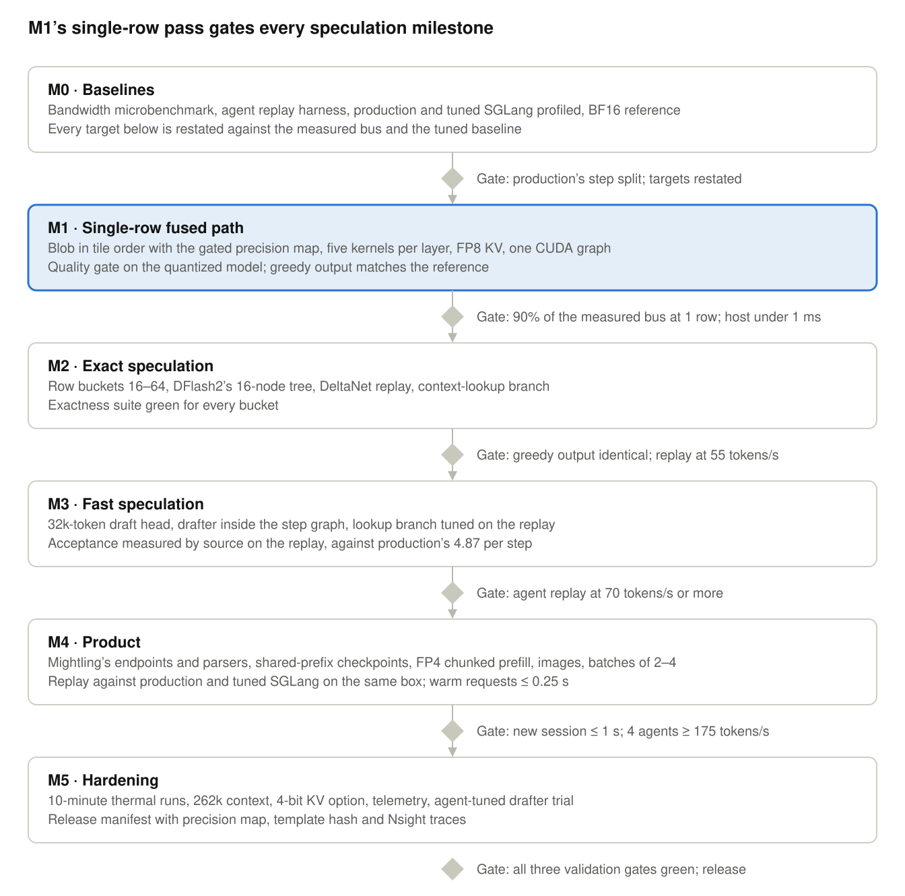

# ling-engine: Milestones, status, the agreement gate and the risks

Part of the ling-engine specification; the index is [README.md](./README.md). Section numbers are those of the single-file `SPEC.md` this was split from (Oct 8, 2026 · revised the same day against Mightling's measured workload), so a citation of the form `§n` or `S§n` in the reports and the code still names the same text.

## 14. Milestones

Six milestones, each gated by a measurement on the Spark; M1 is the long pole, because everything after it multiplies the pass time it establishes. Rough effort for one engineer with review, labelled as an estimate: about four months end to end, M1 taking a third of it, M0 two weeks.

M1 starts as soon as M0's breakdown shows the engine can be meaningfully faster than tuned SGLang, without a separate review (the maintainer's decision, 2026-10-08). All milestone work runs on the development Spark, never on the production machine.

*roadmap · 6 milestones, 6 gates*

Each milestone ends at a measured gate; the highlighted M1 sets the pass time that M2 and M3 multiply.

M0 produces the numbers every later target is restated against (plus the five measurements of [section 16.1](./DREAMFERENCE_LING_ENGINE_RESEARCH.md)): the measured streaming bandwidth; the replay harness and the replay of production; a profile of production's step that splits its ~160 ms; a tuned SGLang and its replay; production's aggregate throughput at 2 and 4 streams; and the BF16 quality reference. If tuning alone closes much of the gap, M0 says so and the targets move up with it. M1 is the single-row fused path and must reach 90% of measured bandwidth before any speculation work starts, so that acceptance is measured against a tight step and not against overhead. M2 and M3 add speculation in two stages, exact first and fast second. M4 turns the engine into Mightling's model server: the endpoints, parsers and template of [section 12](./DREAMFERENCE_LING_ENGINE_INTEGRATION.md), shared-prefix checkpoints, FP4 prefill, images and batches of 2–4, and (since 2026-10-12) structured output. M5 hardens it and tries the agent-tuned drafter.

**Status (9 October 2026).** M0 is done ([reports/M0.md](../reports/M0.md)). M1 is done ([reports/M1.md](../reports/M1.md)): exact speculation with the DFlash2 drafter, 45.5 tokens/s on the replay, 97% of production's decode. Prefill came next, ahead of M2's tree speculation, by the maintainer's choice ([reports/M2-prefill.md](../reports/M2-prefill.md)): from M4, the prompt template of [section 12](./DREAMFERENCE_LING_ENGINE_INTEGRATION.md) (ling-serve's prompts are now token-identical to production's on 396 replayed requests), FP4 prefill ([section 11](./DREAMFERENCE_LING_ENGINE_SESSIONS.md)'s numerics: NVFP4 activations for the FFN, FP8 for the projections, on block-scaled tensor cores; 2,640 / 2,580 / 2,110 tokens/s at 1K / 8K / 35K tokens against production's 2,140-2,460 / 1,930 / 1,680) and shared-prefix checkpoints (a new session resumes after the shared system message). The DeltaNet prefill runs the chunked form in 32-token chunks rather than 64, the KV cache stays BF16, and prefill attention is the rows path's tensor-core kernel. M3, the decode step, is done ([reports/M3.md](../reports/M3.md)): the step's draft, verify and commit as CUDA graphs, programmatic dependent launch, and an L2 prefetch in the verify attention take the step from 115.5 to 110.5 ms on the replay with every output bit unchanged; production's is 105.5, and M3 §7 lists what closes the rest (the weight stream first). Open: M2's tree speculation, the rest of M4 (paged FP8 KV, images, batches of 2-4) and M5. The API and serving fixes from the issue survey are merged (branch `api-fixes`): the four tool-call parser fixes, stop strings held back on UTF-8 boundaries, context overflow in the shapes the clients recognise, the NaN/inf guard, penalties over output tokens only, and chat streams that end properly after an error ([section 18](./DREAMFERENCE_LING_ENGINE_VALIDATION.md) names each guard). Checked on the GPU after merging M3: the kernel, stream and prefill tests, `--spec-check` and `--prefix-check` with and without `--graphs --pdl`, `--graph-check`, and 23 server cases against ling-serve with `--graphs --pdl`.

**Agreement gate (standing, from 9 October 2026).** It replaces the 98.6% top-1 target on validate_v0.py's six prompts, whose 288 tokens cannot detect a change smaller than about 4.5 points ([reports/M2-prefill.md](../reports/M2-prefill.md) [section 6](./DREAMFERENCE_LING_ENGINE_OVERVIEW.md)). Measured with `bench/agreement/` on 54 prompts (validate_v0.py's six, 24 short chat prompts, 24 replayed agent prompts), teacher-forced on production's greedy 48-token continuation, against production at concurrency 1 with a cold cache; a flip is a position where the engine's top token scores strictly below production's top:

- flip rate not significantly above production's own self-noise, its greedy decode against its own prefill on the same positions: a one-sided Fisher exact test (the hypergeometric upper tail, observed table included) at α = 0.05. With production's 65 flips in 2,490 positions the threshold is 85 flips (3.41%): 85 gives p = 0.058, 86 gives p = 0.049;
- every flip's gap (production's top against the engine's choice) ≤ 1.75 nats;
- top-5 agreement 100%;
- no late concentration of flips by position in the continuation or by prompt length;
- tool-name match on the 24 agent prompts' first answers ≥ production's match with itself;
- exact-argument match judged only against production's match with itself (13 of 24 when measured).

M1 (56 flips, 2.25%, p = 0.82), `44c92c5` (68, 2.73%, p = 0.43) and M2 (66, 2.65%, p = 0.50) all pass the flip line; M2 is as far from production as production is from itself. Every other line passes for M1 and M2. `bench/agreement/analyze.py` reports counts, not verdicts; anything that turns them into pass/fail applies this test, with the threshold recomputed from production's own count whenever the prompt set changes.

**Exactness policy.** The engine's numerics are the exact path: decode and verify on the rows path, prefill as M2 built it. Every non-exact mode (a change of numerics, not of speed) sits behind a switch and is off by default. One may become the default only if:

- mean KL(exact engine ‖ mode) ≤ 0.0008 nats (twice production's own warm-against-cold spread at concurrency 1);
- the KL shows no growth with position at 25K and at 64K tokens of context;
- top-5 agreement with the exact engine is 100%;
- tool calls on the 24 replayed agent prompts are no worse;
- `--spec-check` and `--prefix-check` are bit-exact within the mode;
- a SWE-bench night is no worse.

BF16 prefill intermediates may be built behind a switch now. They are: `--prefill-bf16` on `ling-serve` and `ling-run` (`LING_PREFILL_BF16=1`; [CLI §1, §2 and §4](./DREAMFERENCE_LING_ENGINE_CLI.md)) keeps the prefill's DeltaNet intermediates in BF16 (B34), off by default, with `bench/prefill_bf16_check.sh` as the timing and the checks above. **Measured 2026-10-11 (main d58fdd8, GPU otherwise idle): the mode check FAILED, so the switch stays off.** The 35K prefill (34,778 tokens) took 15.42 and 15.39 s with the switch on against 16.50 and 16.49 s off (1.1 s, 6.6% faster); the prefix check and the spec check pass with it on. Against the exact engine on the agreement study's 54 prompts (2,490 positions): mean KL 0.004217 nats (limit 0.0008), p99 0.0568, max 1.571 (prompt 23, position 0, 26 tokens), 46 top-1 flips (1.85%), top-5 agreement 2,489/2,490 (99.96%, limit 100%); by length <1K 0.0053, 8–16K 0.0023, 16K+ 0.0031. At the 35K prompt: mean KL 0.0237, 2 top-1 flips in 48 positions, top-5 100%. Against production's cold reference the two are alike: mean KL 0.012397 for the exact engine and 0.012388 with the switch on, so the mode moves ling-serve no closer to production and no further from it. FP8 KV (§16.10) and the all-NVFP4 projections (§16.2) wait until the exact engine has beaten SGLang in a night.

**Backlog (9 October 2026).** The surveys of 9 October are merged and ranked in [reports/backlog-2026-10-09.md](../reports/backlog-2026-10-09.md); only measured wins move from it into this spec.

**Target: a benchmark night (set 10 October 2026).** The Code Mode A/B benchmark night (50 SWE-bench tasks, two in parallel, about 16 hours) runs the day ling-engine can be the benchmark harness's model server for a whole night. The bar (the owner's decision, 2026-10-10): two tasks served at once at no less than production's two-stream numbers ([reports/M0.md](../reports/M0.md) §4: 33.9 tokens/s per stream, a 145 ms step period), the harness admitting two tasks, no restart over 8 hours, 35K-token prefills at the harness's pace, and the harness's probes and metrics answered. Where ling-serve stands at `2288f21` is in [reports/benchmark-night-gap-2026-10-11.md](../reports/benchmark-night-gap-2026-10-11.md): the probes and metrics are answered (`/health`, the one-token chat canary, `/v1/models`, `/metrics` with the admission gauges; established from the harness's source, not yet exercised by the harness against ling-serve). The gaps: (1) one request at a time, so two streams are never decoded together: each decodes alone at the single-stream rate (55.5 tokens/s on the tuning set at 12 drafts; 48.3 on the soak's first cold request) and waits behind the other (16 s of wait and prefill in a 24 s request), against 33.9 tokens/s per stream with no wait in production; (2) `sglang:max_total_num_tokens` reports 65,536, one resident history, so the harness's parallelism is 65,536 × 0.9 // 49,152 = 1 against the 2 the night needs (a pool of at least 109,227 tokens); (3) one resident history, so two interleaved sessions evict each other and re-prefill from the last checkpoint every turn ([BACKLOG §19](./DREAMFERENCE_LING_ENGINE_BACKLOG.md) item 8), and a 35K prefill (17 s at 2,110 tokens/s) stalls the other stream for its whole length; (4) the 8-hour run without a restart is unproven until the soak of 10 October (M0's main set at two streams, pass after pass) is read in the morning. All of it closes in M4: resident sessions and batches of two, which the owner decided to build together (2026-10-10), with the pool gauge reporting sessions × context once sessions are resident and a prefill chunk interleaved between decode steps ([section 11](./DREAMFERENCE_LING_ENGINE_SESSIONS.md)). With the engine as it is, the harness runs the 50 tasks one at a time; M0 states no request count per task, so the night's length is to be measured, between about 19 and 32 hours by the report's bounds, past the 16-hour window either way. **M4 stage 1, resident sessions, is done (2026-10-11, [drafts/M4 §6](./drafts/M4-sessions-and-batches-2026-10-10.md), "Stage 1 as built"):** two sessions resident (`ling-serve --sessions 2`, 4.77 GB each at 65,536 tokens), each request bound to the session it extends (`prompt_cache_key` first, the token prefix deciding), the checkpoint store keyed by its own token prefix, the drafter's context as a ring, and keyed sessions protected from eviction for 30 s after their last request (180 s as first built; 30 s by the owner's decision of 2026-10-11) (a third client queues). That closes gap (2), `sglang:max_total_num_tokens` = 131,072 so the harness admits two tasks, and the eviction half of gap (3): two alternating tasks each stay warm. Requests still run one at a time (gap (1) and the prefill stall are stages 2 and 3). Every exactness check passes and the single-stream step is 107.0 ms on the replay, the same as main's 107.1 ms measured the same day (M3: 110.5). **M4 stage 2, the interleaved scheduler, is merged into main (built 2026-10-12 on branch `m4/stage2`; [drafts/M4 §6](./drafts/M4-sessions-and-batches-2026-10-10.md), "Stage 2 as built"):** two requests run at once, each in its own session, taking turns one prefill chunk or one decode step; a prefill beside a decode runs in 256-token chunks. On the replay at two streams: 22.1 tokens/s per stream at a 219 ms step period (the gate's line is 33.9 and 145: stage 3's batched verify), single stream 108.2 ms; every exactness check passes, with new `--chunk-check` and `--interleave-check`. A 34K-token prefill beside a decode stretches the decoding stream's step period from 98 to 286 ms (mean), where one request at a time made the other wait out the whole prefill (17 s); about twice the normal step is out of reach of chunking alone. The owner's decision of 2026-10-12: stage 2's bound is read against the two-stream period (~220 ms; 256 keeps the mean at 1.3 times it), stage 2 merged, stage 3 next; the bound against the single-stream step returns with the mixed batch. **M4 stage 3, the batched verify, is merged into main (built 2026-10-12 on branch `m4/stage3`; [drafts/M4 §6](./drafts/M4-sessions-and-batches-2026-10-10.md), "Stage 3 as built"):** two decoding requests verify their rows in one pass (`Engine::speculate_batch`), the drafter, the state kernels, the accept and the commit per sequence, eager. On the replay at two streams: 30.7 and 31.2 tokens/s per stream at a 157 ms step period (main the same evening: 23.5 at 216.5 ms), 46 output tokens/s over both; the batched step itself is about 137 ms, under the gate's 145, but 13–14% of a stream's steps wait for a chunk of the other stream's prefill (265 ms), which is the mixed batch's to remove. Single stream 102.4 ms (main the same evening 103.9). Every exactness check passes, with the new `--batch-check`. The checkpoint store's full rule is now least recently used (the owner's decision of 2026-10-12). **M4 stage 4 is merged into main (built 2026-10-13 on branch `m4/stage4`, merged the same day by the owner's decision; "Stage 4 as built"):** the state kernels in one launch over both sequences, the drafter over both blocks at once, and step graphs for the batch path. The batched step is about 130 ms (stage 3: 137); on the replay at two streams 34.8 and 32.2 tokens/s per stream at 149.6 and 153.8 ms, pooled 33.4 at 151.9 against the gate's 33.9 and 145; the rest of the gap is the other stream's prefill chunks (13–14% of steps at about 267 ms), for the mixed batch or the step savings block. Single stream 104.2 ms; every exactness check passes, `--batch-check` with the batch path's own graphs included.

**The bar for production (the owner's decision, 2026-10-14).** ling-engine replaces SGLang as Mightling's model server when three things hold, in this order: (1) the seeded replays (`bench/replay/replay.py --sampling-seed`, M0's main set) are no slower than production at one stream and at two; (2) one SWE-bench night A/B, the engine against SGLang serving the same agent on the same tasks, shows no significant loss (the nights' McNemar test, as the Code Mode nights use it); (3) a 48-hour soak serving real traffic on node-b without a restart. Then the engine becomes the default on node-b first and on the development machine a week later. Nothing beyond the record is scheduled by this decision; the gate run of stage 5 and the step savings feed (1), the night (2) runs when (1) holds. **(1) is met (the owner's decision of 2026-10-16: two streams within production's own run-to-run spread count as no slower).** One stream: 49.3 tokens/s at 101.1 ms against production's 48.0 at 107.3 (stage 5; 48.0 at 101.0 with the prompts made identical, 2026-10-16); two streams: 34.25 tokens/s per stream pooled against production's 36.1 and 33.0 (34.6 pooled), inside production's spread between its own two runs. Next for the bar: the SWE-bench night A/B (2), after the two-stream prefill and the megakernel (the owner's order of 2026-10-16).

**Status (12 October 2026).** M4 stage 2 is merged into main (`17b292b`), with question 3's bound read against the two-stream period (~220 ms) until the mixed batch exists. Stage 3, the batched verify, is merged into main (2026-10-13; the target paragraph above, and [drafts/M4 §6](./drafts/M4-sessions-and-batches-2026-10-10.md), "Stage 3 as built"), and stage 4 is merged too (2026-10-13; the target paragraph above); stage 3 also changed the checkpoint store's policy when full from stage 1's "the latest position gives way" to LRU eviction (the least recently used entry gives way), the case stage 2's server run showed (`test_prompt_length_near_chunk_boundary[2080]` on a server whose store was full of earlier entries, [drafts/M4 §6](./drafts/M4-sessions-and-batches-2026-10-10.md), "Stage 2 as built"). Single stream: the step is 107–108 ms on the replay (stage 1 107.0, stage 2 108.2; stage 3 102.4 on a day when main itself measured 103.9) against tuned production's ~103 ms at 12 draft tokens (M3's 105.5 ms above is production's own, at 16); tokens/s varies with the sampled acceptance, 4.94–5.26 tokens per step between runs (44.9–48.3 tokens/s of decode), and no stage has regressed it (question 8's bound: within noise of M3's 110.5 ms).

**Order (the owner's decision, 2026-10-12; revised 2026-10-13).** After today the work runs in this order:

1. M4 finishes its batching stages ([drafts/M4 §6](./drafts/M4-sessions-and-batches-2026-10-10.md)): stage 3, the batched verify (merged 2026-10-13); stage 4, one launch per state kernel and graphs for the batch path (merged 2026-10-13); then the single-step savings (decided later the same evening): B16, the weight stream (~6 ms; merged 2026-10-14: −2.3 ms on the one-stream step and −7 ms on the batched step, all of it at 17-32 rows and on the narrow matrices, since the GEMMs already streamed at 233-244 GB/s at 1-16 rows; [drafts/M4](./drafts/M4-sessions-and-batches-2026-10-10.md) "The step savings as built"); B07, the verify attention's stages (1–1.5 ms per sequence); B07 not merged (the kernel already reads at the plain-read rate; a third stage was slower at two streams); the commit overlapped with the next draft on a second captured stream ([reports/M3.md](../reports/M3.md) §7 item 4, ~2 ms; merged 2026-10-14: −1.0 ms on the one-stream step, −1.7 ms batched); B31, the draft block at batch 2 ([reports/backlog-2026-10-09.md](../reports/backlog-2026-10-09.md); measured 2026-10-14 and closed: a block of 16 is about 1% faster than 12 per sequence at two streams on the batched pair, within the replay's spread, so the default stays 12 and the knob, `--draft-block-batch`, waits on branch `steps/b31` for stage 5, which reports 16 beside 12); the drafter's context-aware sparse head ([BACKLOG §19.19](./DREAMFERENCE_LING_ENGINE_BACKLOG.md), added the same evening, ~2–2.5 ms expected; built and not merged 2026-10-14, branch `steps/sparse-head`: −1.6 ms on the step, but −6.4% tokens per step on six multilingual prompts, the gate's multilingual condition); and B26, lossless smaller NVFP4 scale codes decoded in registers in `stream_gemm` ([reports/backlog-2026-10-09.md](../reports/backlog-2026-10-09.md) B26, [RESEARCH §16.4](./DREAMFERENCE_LING_ENGINE_RESEARCH.md); added the owner's decision of the night of 2026-10-12): about 0.43–0.5 GB fewer bytes per step, −1.8 to −2.5 ms expected, measured after B16 since it shares B16's tile layout; merged 2026-10-15: −1.6 ms on the one-stream step in place, −1.0 ms batched, seeded replays 102.7 → 100.8 ms at one stream and 147.6 → 146.6 ms per stream at two (+0.86 GB of memory for the prefill's raw copy of the scales; [drafts/M4](./drafts/M4-sessions-and-batches-2026-10-10.md) "The step savings as built"). Last in the block, the drafter's NVFP4 scales re-fitted (ScaleSearch, [BACKLOG §19.22](./DREAMFERENCE_LING_ENGINE_BACKLOG.md); the owner's decision of 2026-10-13), only if a gap shows: first an acceptance A/B of the BF16 drafter against the served NVFP4 one at 12 drafts on the replay (about 1 GPU-hour), since the drafter's card calls its 3.60 against 3.71 parity within ±0.2 noise; re-quantized only if BF16 wins by more than the noise, at the same step cost. Closed 2026-10-15 without re-quantizing: BF16 over NVFP4 1.023 accepted per step (95% interval 0.983–1.066) against 3–4.5% between seeds within one arm. Reopened by the owner (2026-10-16) and done 2026-10-17: ScaleSearch, 27% less weight error, the same format and step cost; accepted per step x1.055 on SGLang and x1.021 on ling-serve, paired by request (BACKLOG §19.22); production's drafter switch is the owner's item. Each is exact, is measured on its own and is kept only if it gains. The goal is about 10 ms off the ~108 ms single-stream step, which puts the engine about 5% ahead of tuned production on one stream (~103 ms) and further ahead at two streams; the estimate is one extra week. Then the moonshot's P1 on the GPU: its GPU tests and first numbers ([drafts/MOONSHOT §5](./drafts/MOONSHOT-repository-aware-decoding-2026-10-13.md); its CPU parts are written beside the step savings, on branch `moonshot/p1`; the owner's decision of 2026-10-13). Run 2026-10-15 and not merged (branch `steps/p1-on-b26`, [drafts/MOONSHOT §8.9](./drafts/MOONSHOT-repository-aware-decoding-2026-10-13.md) there): every exactness check passes and the outputs are byte-identical in every arm, but the faster mode, extend, gains x1.012 on M0's main set and replace loses (x0.924), short of P1's +7% gate; what comes next for the moonshot is the owner's. Then stage 5, the gate run, which measures the kept savings and P1 together against production (without P1, which was not kept). Measured 2026-10-15 ([drafts/M4](./drafts/M4-sessions-and-batches-2026-10-10.md), "Stage 5, the gate run, as measured"): per-stream decode at two streams 34.25 tokens/s (line 33.9, met), the step period 146.6 ms (line 145, missed by 1.6 ms), the aggregate 45.5 output tokens/s (line 49.4, missed: prefill at two streams); the 991 tokens every engine replay prefilled more than production were Code Mode's `exec`, a custom tool SGLang drops (2026-10-16): with the prompts made identical, 46.9 and 47.0 tokens/s, prefill still 266 s against production's 188-195 s, one stream 101.1 ms and 49.3 tokens/s against production's 107.3 ms and 48.0 the same session; the 8-hour soak passed (no restart, memory flat; 2026-10-15/16). The two measurements after it ran 2026-10-16 (BACKLOG §19.24: Z about 4.1 ms, 1 ms of it idle; §19.25: about 0.5% per GB/s of CPU traffic, the indexer and a pytest container under 0.5%). Then two measurements, no engine code (the owner's decisions of 2026-10-14, outside the production window of the compaction bench): B08's trace of one decode step's inter-kernel bubbles and the bandwidth 8, 16, 24 and 48 SMs reach, which pins the bubble ceiling Z (5–8 ms estimated) and splits it into idle bus and small-matrix inefficiency ([BACKLOG §19.24](./DREAMFERENCE_LING_ENGINE_BACKLOG.md), a few hours), and decode at one and two streams beside a CPU neighbour (a synthetic memory stream at 5, 10 and 20 GB/s, then the real `ling-code` indexer, then a pytest container; [BACKLOG §19.25](./DREAMFERENCE_LING_ENGINE_BACKLOG.md), about two hours), which decides whether Mightling's admission needs a bandwidth budget. Then, before structured output (item 2), cuBLAS removed (the owner's decision of 2026-10-14, [BACKLOG §19.23](./DREAMFERENCE_LING_ENGINE_BACKLOG.md)): its one call, the BF16 GEMM for more rows than `kMaxStreamRows` (prefill only, never in a step graph), replaced by a tiled BF16 GEMM of the engine's own, no slower than cuBLAS on those matrices and exactness-gated, then `cublas` and `cublasLt` dropped from the link; bundled with the prefill inside the schedule ([drafts/M4 §6](./drafts/M4-sessions-and-batches-2026-10-10.md) item 6). Done 2026-10-16 and merged by the owner's decision (BACKLOG §19.23): exact (bit for bit cuBLAS's result on the drafter's fc, every gate passes on the rebased tree) and cuBLAS out of the link; x1.03 against cuBLAS on a 2,048-row chunk (x0.92-0.99 at 256-1,000 rows) accepted because the prefill in place and the one-stream replay are unchanged. Before batches of three or four sequences, a small-N path for the drafter's BF16 matrices.
2. **Structured output**, inside M4, first after M4's stage 5 (the owner's decision of 2026-10-13: structured output before images): grammar-constrained decoding, for `response_format` with a JSON schema, an enforced `tool_choice: "required"`, and the custom-tool grammars that today are only appended to the tool's description. Scope: [BACKLOG §19.17](./DREAMFERENCE_LING_ENGINE_BACKLOG.md).
3. **Images**, inside M4, after structured output: the vision encoder. Today ling-serve renders an image part as the text `[image]` ([API §7](./DREAMFERENCE_LING_ENGINE_API.md)); production Qwen3.8 on SGLang reads images, and Mightling 1.6.0's Ask sends them. Scope: [BACKLOG §19.16](./DREAMFERENCE_LING_ENGINE_BACKLOG.md).
4. M2's tree speculation.
5. M5, hardening and release, as the roadmap has it: 10-minute thermal runs, 262k context, the 4-bit KV option, telemetry, the agent-tuned drafter trial, and the release manifest (precision map, template hash, Nsight traces); its gate is all three validation gates green (exactness, quality and the benchmark, [section 13](./DREAMFERENCE_LING_ENGINE_VALIDATION.md)). At M5's release gate the engine replaces SGLang as Mightling's default; SGLang stays the fallback until then ([INTEGRATION §12](./DREAMFERENCE_LING_ENGINE_INTEGRATION.md)).

Items 2 and 3 restore the roadmap's "M4 · Product" scope: images were in the roadmap's M4 and were dropped when M4 was narrowed to sessions and batches; structured output is new to M4. Why this order: the functional gaps against production that matter for Mightling's own use are images and structured output; the rest (more than two streams, a paged and shared prefix cache, the mixed prefill+decode batch, `n` > 1) matters for serving many users. The functional gaps close before more speed work beyond the single-step savings of item 1, so drafts/M4's stage 6 and the mixed batch are outside this order.

Last in the engine plan (the owner's decision of 2026-10-13; "after M5, not scheduled" since the night of 2026-10-12): one model across both GB10s by two-node tensor parallelism, after every one-node improvement is settled (M4 and the step savings, the moonshot's P1, M4's stage 5, structured output and images, M2's tree speculation, M5, the moonshot's phases and every other single-node BACKLOG item), when the owner will take it up; estimated at 1.5–1.8× on decode and to be measured first ([BACKLOG §19.21](./DREAMFERENCE_LING_ENGINE_BACKLOG.md), [drafts/two-node-tp-2026-10-12.md](./drafts/two-node-tp-2026-10-12.md)).

## 15. Risks and open questions

The two risks that can sink the targets are the bus and the toolchain; the third is that the gap closes from the other side.

| Risk | Effect if it lands | Mitigation | Decided by |
| --- | --- | --- | --- |
| Sustained LPDDR5x bandwidth well below 273 GB/s (CPU traffic shares the pins) | Every tokens/s target scales down with it | Measure in M0; restate targets; keep the CPU idle during decode (no tokenization or copies on the hot path) | M0: **did not land** (262 GB/s, 96%); CPU streams take bandwidth byte for byte, so the CPU-idle rule stands |
| Production's 65 ms of non-byte step time is mostly something the engine cannot remove (attention at long context, for example) | Step target slips toward 100 ms; decode toward 60 tokens/s | M0's profile splits it before M1 starts; the flash-decoding attention kernel is built and measured in M1 | M0: **moot** — the single-stream step is 105 ms, not 160, and its non-GEMM part is ~19 ms (DeltaNet 7.5, attention 6.1 at bandwidth, drafter 8.6 incl. GEMMs, commit and sampling 3.5); the GEMMs themselves run at 78% of the bus |
| Tuned SGLang closes much of the gap first | The engine's margin over the tuned baseline shrinks | Every gate is stated against the tuned number; M0's tuned run is the go/no-go for M1; useful tunings ship in production at once | M0 |
| CUTLASS and the CUDA toolchain lack mature block-scaled NVFP4 and FP8 MMA kernels for sm_121 at small M | M1 slips | Prototype the FFN kernel first, both NVFP4 and FP8, before committing the layout; FP8 is the documented fallback precision | M1 |
| The FP8 projections fail the quality gate at NVFP4 | They stay FP8; step at 25k is ~88 ms instead of ~76 | Targets are already stated both ways; move groups one at a time | M1 |
| The lookup branch gains less than simulated (both sources succeed on the same spans) | Acceptance ~5.3 instead of 5.8; decode ~62 tokens/s | Measured on the replay in M2; the 64-token branch and an agent-tuned drafter are the next levers | M2 |
| The drafter's 32k-token head costs acceptance | Decode falls by a few percent | Measure separately; 64k head as fallback | M3 |
| The DeltaNet replay interacts badly with tree speculation and batches (per-branch replays exceed the L2 budget) | Tree capped at 16 nodes; batches at 2 | Measure state traffic in M2; the chain path is unaffected | M2 |
| Shared-prefix checkpoints miss because Codex's prefix varies per session (dates, paths early in the prompt) | New sessions start slower than 1 s | M4 measures the hit rate on replay; the prefix layout is Mightling's to change if needed | M4 |
| Thermal throttling at the 140 W TDP during long decodes | Pass time drifts up after minutes | Record clocks in telemetry; benchmark runs of 10 minutes, not 10 seconds | M0 |
| The Qwen3.8 chat template or tool-call format changes in a model update | Prefix check triggers re-prefill on every turn | Pin the template hash in the manifest; re-prefill path is already required | M4 |
| An agent-tuned drafter overfits one user's sessions | Acceptance falls on new kinds of work | Hold out recent sessions; keep the shipped drafter as the fallback and pick per request class by measured acceptance | M5 |

Open questions:

- Does the SM120 block-scaled MMA path on sm_121 reach 90% of bandwidth at M = 1 and M = 16, or does the 1-row bucket need a separate dequant-and-FMA kernel over the same tile layout? (M0: the instructions exist and work on sm_121a — `mma.sync` `kind::mxf4nvf4.block_scale` and `kind::f8f6f4`, TMA, clusters of up to 8 with distributed shared memory, programmatic dependent launch; at M = 16 production's CUTLASS NVFP4 GEMMs reach 208–225 GB/s and cuBLASLt's FP8 ones 140–218.)
- ~~Where do production's ~65 ms of non-byte step time go?~~ Answered by M0 ([reports/M0.md](../reports/M0.md) [section 5](./DREAMFERENCE_LING_ENGINE_MODEL.md)): one stream's 105 ms step is 86 ms of GEMMs at 204 GB/s plus ~19 ms of DeltaNet, attention, drafter and sampling; the GPU idles ~1 ms. It moved lever 5 (batching) up and lever 3 (short requests) down.
- What is the first-token latency floor once tokenization and HTTP are included: is 0.25 s for a warm agent request comfortable, and how close to one pass can a short follow-up get?
- How much of the copyable output does the lookup branch capture once the two draft sources overlap, and does a cross-session suffix store (proposals from earlier sessions' outputs, not just this one's context) add to it?
- Is a 4-bit KV cache needed for sessions above 64k tokens, or is FP8 enough for the users this engine serves?
